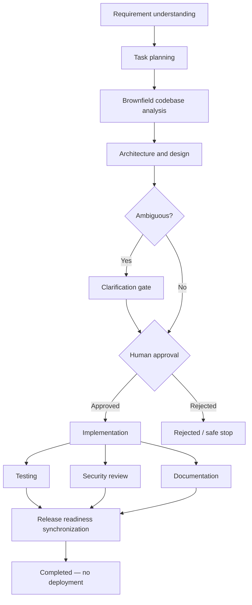

# Agentic URL Shortener — Architecture and Engineering Decisions

## 1. Existing application (brownfield baseline)
The repository contains a React/Vite frontend and a Spring Boot 3.4 / Java 21 backend. The backend already has JWT registration/login, URL mapping CRUD, redirects, click events, and SQL persistence. The agentic layer is added under `com.url.shortner.agent` and `com.url.shortner.agent.v2`; existing URL APIs remain under `/api/urls`.

## 2. Components
- **REST/API layer** — `/api/agentic/**` is the legacy in-memory API; `/api/v2/workflows/**` provides durable workflow operations and owner-scoped metrics.
- **Orchestrator** — legacy `AgenticWorkflowService` is the in-memory demo; `WorkflowV2Service` persists workflow runs/tasks/audit, validates DAG dependencies, gates implementation, retries bounded attempts and safe-stops on failure.
- **Bounded agents** — requirement, planning, codebase-analysis, design, implementation, testing, documentation, and release-readiness tasks. Current adapters are deterministic demonstration agents; they do not call an external LLM.
- **Policy / human gate** — implementation cannot start until an authenticated workflow owner approves the current requirement and upstream artifact hash; independent reviewer RBAC is not yet implemented. Release readiness never deploys automatically.
- **Audit trail** — every stage transition and approval decision is timestamped with actor/action/details.
- **Metrics** — v2 exposes owner-scoped run counts, success rate, retry events and safe-stop events. True rollback frequency, measured latency and MTTR remain future work.

## 3. Dependency graph and control flow

The testing, security and documentation tasks are independent children of implementation and synchronize at release readiness. They currently execute sequentially in the request thread; durable parallel worker fan-out is not implemented. Each task has explicit dependencies; a task cannot run until all dependencies succeed.

## 4. Governance and safety
- No deployment, production mutation, or external side effect is performed by the agent.
- Implementation is held behind a human approval endpoint.
- Rejection is recorded in the workflow status and audit trail; no implementation task is executed.
- Task retries are bounded; unexpected failure transitions the run to `SAFE_STOP`.
- Replanning invalidates prior successful task outputs and reruns upstream stages, returning to the approval gate.
- URL destinations accept only absolute HTTP/HTTPS URLs; `javascript:`, `file:`, and relative destinations are rejected.
- Secrets are read from environment variables. Never commit real database credentials or production JWT secrets.
- Existing URL update/delete operations retain owner checks.

## 5. Key decisions and trade-offs
| Decision | Rationale | Trade-off |
|---|---|---|
| Add orchestration to existing Spring Boot service | Brownfield enhancement; preserves API and UI | Prototype is a modular monolith, not a distributed agent platform |
| Explicit DAG | Makes dependencies and synchronization reviewable | DAG is currently defined in code |
| Deterministic agent adapters | Runnable and reproducible without LLM keys | Does not demonstrate model quality/tool calling |
| Durable v2 workflow state | Runs/tasks/audit survive restart | Execution remains synchronous and request-bound; add queue workers for multi-instance use |
| Human approval before implementation | High-impact change-control boundary | Reviewer identity/role mapping needs enterprise IAM integration |
| No automatic deployment | Safe default | Release step reports readiness only |
| MySQL local default | Matches included Docker Compose | Flyway migrations target MySQL 8.0 |

## 6. Production hardening backlog
1. Move synchronous request-bound task execution to durable queue workers with leases, cancellation, stale-lease recovery and an outbox.
2. Add idempotency keys for run creation and approval actions; optimistic locking is already present on v2 run/task rows.
3. Integrate a real LLM through a provider abstraction with strict tool allow-lists and JSON-schema output validation.
4. Execute task workers asynchronously through a durable queue; add leases, timeouts, cancellation, and dead-letter handling.
5. Enforce reviewer RBAC and separation of duties through enterprise identity.
6. Add code-diff sandboxing, SAST/dependency scanning, SBOM generation, and signed build artifacts.
7. Replace prototype latency/MTTR estimates with measured task/run telemetry and incident recovery timestamps.
8. Add rate limiting, abuse detection, URL reputation checks, and retention controls for click analytics.
